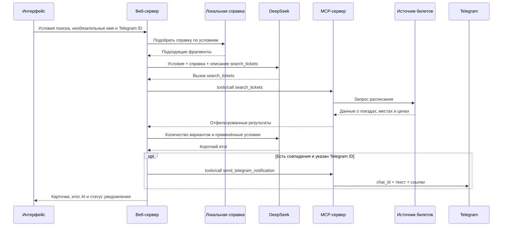

# RailScout — AI-агент поиска железнодорожных билетов

RailScout помогает найти подходящие билеты на сайте [БЖД](https://pass.rw.by/) и следить за их появлением. Пользователь задаёт условия в форме, получает список поездов с ценами и при необходимости включает уведомления в Telegram.

Приложение решает задачу повторной проверки расписания: человеку не нужно постоянно открывать сайт и вручную отсекать неподходящее время или типы мест. Покупку и выбор конкретного места пользователь завершает на сайте БЖД.

**Стек:** HTML, CSS и JavaScript в браузере; JavaScript и Node.js на сервере; DeepSeek API; MCP по stdio; локальная RAG-справка. Приложение самостоятельно и находится в этом каталоге.

## Пример использования

Предположим, Тамаре нужен билет из Минска в Витебск на выбранную дату:

1. Она вводит имя, маршрут и дату. Имя необязательно: поле изначально пустое с подсказкой «Например, Тамара».
2. Устанавливает время отправления с 14:00 до 20:00 и выбирает купе.
3. Добавляет исключение 19:08–19:08, чтобы не получать поезд с этим временем отправления.
4. Нажимает «Найти подходящие билеты». Telegram ID можно оставить пустым — результаты появятся в интерфейсе.
5. В карточках видит номер поезда, отправление и прибытие, количество мест, цены и ссылку «Открыть источник». AI отдельно формулирует короткий итог поиска.
6. Для уведомлений вводит Telegram ID в скрытое поле и выбирает интервал проверки, например 1 минуту. После запуска мониторинга сервер проверяет маршрут сразу, затем по расписанию.
7. При первом непустом результате бот присылает сообщение с итогом DeepSeek. Следующие сообщения приходят при изменении результата: AI сравнивает предыдущие и новые данные и объясняет, что изменилось. По ссылке можно перейти к выбору вагонов и мест.

Это пример условий поиска. Фактические поезда, наличие и цены определяются ответом источника.

## Быстрый запуск

Требуется **Node.js 22.5 или новее**. В текущем приложении используются встроенные модули Node.js; установка сторонних npm-пакетов не требуется.

1. Если настройки уже есть в корневом `.env` репозитория, используйте их. Иначе создайте `ticket-agent/.env` по образцу [`.env.example`](.env.example) либо добавьте нужные переменные в существующий корневой `.env`:

   ```env
   DEEPSEEK_API_KEY=ваш_ключ_DeepSeek
   DEEPSEEK_MODEL=deepseek-flash
   TELEGRAM_BOT_TOKEN=
   ```

   Ключ DeepSeek нужен для разового AI-поиска и объяснения изменений мониторинга. Токен Telegram нужен для уведомлений и мониторинга; для вывода результатов в интерфейсе он необязателен.

2. Запустите из **корня репозитория**:

   ```powershell
   npm run start:ticket-agent
   ```

   Альтернатива: выполните `npm start` из каталога `ticket-agent`. Команда `npm start` из корня запускает предыдущий проект AI Chat.

3. Откройте [локальный интерфейс RailScout](http://127.0.0.1:3035).
4. Для уведомлений заполните `TELEGRAM_BOT_TOKEN`, начните диалог с ботом в Telegram, введите ID чата в интерфейсе и нажмите «Проверить Telegram».

После изменения настроек окружения перезапустите сервер. Активные мониторинги при этом потребуется создать заново.

### Настройки окружения

| Переменная | Назначение |
| --- | --- |
| `DEEPSEEK_API_KEY` | Ключ для разового AI-поиска и итогов мониторинга. |
| `DEEPSEEK_MODEL` | Модель DeepSeek. Значение по умолчанию в коде — `deepseek-flash`. |
| `TELEGRAM_BOT_TOKEN` | Токен бота для тестового сообщения, уведомлений поиска и мониторинга. |
| `TICKET_AGENT_PORT` | Порт веб-сервера, по умолчанию `3035`. |
| `TICKET_AGENT_PUBLIC_URL` | Доступный пользователю адрес приложения для ссылок на выбор мест. По умолчанию используется локальный адрес. |
| `TICKET_AGENT_LINK_PAGE_URL` | HTTPS-адрес отдельной статической страницы выбора мест для Telegram. При заполнении имеет приоритет над ссылкой на сервер приложения в уведомлениях. |
| `RAILWAY_BASE_URL` | Базовый адрес HTML-источника, по умолчанию `https://pass.rw.by`. |
| `RAILWAY_SEARCH_URL` | Необязательный JSON endpoint. При заполнении заменяет HTML-поиск. |
| `RAILWAY_API_TOKEN` | Необязательный Bearer-токен собственного JSON-провайдера. |

Приоритет настроек: **окружение процесса → `ticket-agent/.env` → корневой `.env`**. Даже пустое значение в файле приложения перекрывает одноимённое значение корневого файла. Если корневой `.env` уже настроен, копировать образец поверх него не нужно.

## Как проходит разовый поиск: по шагам

1. **Форма → веб-сервер.** Браузер передаёт маршрут, дату, время, исключения, типы мест и необязательные имя и Telegram ID.
2. **Подготовка условий.** Сервер выделяет условия поиска и проверяет обязательные поля. Имя и Telegram ID в условия для модели не входят.
3. **RAG.** Сервер находит подходящие разделы локальной справки и добавляет их к инструкции для DeepSeek.
4. **Первый запрос к DeepSeek.** Модель получает условия, справку и описание инструмента `search_tickets`. Она формирует вызов инструмента.
5. **Вызов через MCP.** Веб-сервер выполняет этот вызов через MCP-клиент. Перед выполнением условия из формы имеют приоритет над аргументами модели.
6. **Получение и фильтрация.** MCP-инструмент запрашивает источник билетов. Код разбирает расписание, наличие и цены, затем применяет ограничения.
7. **Итог AI.** Сервер передаёт DeepSeek количество найденных вариантов, условия и признак применения фильтров. Модель пишет короткий итог. Полный список поездов, цены и ссылки остаются в данных для интерфейса и Telegram.
8. **Результаты и уведомление.** Интерфейс получает карточки поездов и итог AI. Если найдены совпадения и указан Telegram ID, сервер отдельно вызывает MCP-инструмент `send_telegram_notification`.

Обычный успешный разовый поиск использует два обращения к DeepSeek: вызов инструмента и итоговое описание.



## Роль AI

В текущей реализации DeepSeek выполняет ограниченный сценарий агента: вызывает разрешённый инструмент поиска и объясняет результат с учётом справки. Модели доступен только `search_tickets`.

В мониторинге сервер сравнивает последний успешно сообщённый результат с новым. При изменении доступности Telegram получает данные источника напрямую, без ожидания DeepSeek. Telegram ID, имя, токен и ссылки на выбор мест не отправляются модели.

Проверка времени, типов мест, наличия и исключений реализована кодом. Условия задаются полями формы; свободный диалог для планирования поездки пока не реализован. При разовом поиске AI формулирует общий результат, а подробности каждого поезда отображаются в карточках.

## Как используется MCP

[Веб-сервер](server.mjs) запускает [MCP-сервер](mcp-server.mjs) как дочерний процесс. [MCP-клиент](lib/mcp-client.mjs) обменивается с ним JSON-RPC сообщениями через стандартные потоки ввода и вывода — stdio.

| Инструмент | Что делает | Кто вызывает |
| --- | --- | --- |
| `search_tickets` | Получает билеты и применяет ограничения. | Веб-сервер по запросу DeepSeek. |
| `start_monitoring` | Запускает немедленную и периодические проверки. | Веб-сервер по нажатию кнопки пользователем. |
| `stop_monitoring` | Останавливает выбранный мониторинг. | Веб-сервер по нажатию кнопки пользователем. |
| `list_monitors` | Возвращает статус текущих мониторингов. | Веб-сервер при обновлении статуса интерфейса. |
| `send_telegram_notification` | Отправляет текст и ссылки в указанный чат. | Веб-сервер после разового поиска или для тестового сообщения. |

DeepSeek возвращает описание вызова функции; его исполнение через MCP организует веб-сервер. Модель не подключается к MCP-процессу самостоятельно.

Во время фонового мониторинга MCP-сервер сам вызывает функции поиска и отправки Telegram внутри своего процесса. При первом совпадении и изменении результатов он обращается к DeepSeek за итогом. При неизменных данных запрос к AI не выполняется. Отправка из цикла мониторинга использует функцию Telegram внутри MCP-процесса.

## Как используется RAG

RAG добавляет к запросу модели фрагменты внешней для неё справки. Источник — файл [`knowledge/rail-rules.md`](knowledge/rail-rules.md): типы мест, условия поиска, уведомления и ограничения источника.

Текущий алгоритм в [`lib/rag.mjs`](lib/rag.mjs):

1. Читает справку и делит её на фрагменты по заголовкам `##`.
2. Собирает поисковую строку из маршрута, выбранных типов мест и слов «поиск места время».
3. Приводит слова к нижнему регистру и считает точные совпадения слов запроса со словами каждого фрагмента.
4. Выбирает до трёх фрагментов с наибольшим положительным числом совпадений.
5. Включает их в системную инструкцию DeepSeek. Использованные фрагменты доступны в интерфейсе.

Например, для строки «Минск Витебск купе поиск места время» текущая справка возвращает разделы «Типы мест» и «Условия поиска».

**Введённая форма не записывается в документ.** Маршрут и ограничения передаются как структурированные данные. Справка содержит общие правила, а текущее наличие и цены приходят из источника билетов.

Здесь реализован простой поиск по словам: без эмбеддингов, векторной базы и семантического поиска. Он зависит от совпадения форм слов и может не найти справку по синонимам. Изменение справки влияет на контекст модели; изменение самих правил фильтрации требует изменения кода.

## Откуда берутся билеты и цены

По умолчанию [адаптер](lib/railway.mjs) делает GET-запрос к странице расписания:

```text
https://pass.rw.by/ru/route/?from=...&to=...&date=YYYY-MM-DD
```

Города передаются как строки из формы. Парсер читает HTML-блоки расписания, включая `.sch-table__row-wrap`, время отправления и прибытия, `.sch-table__t-name`, `.sch-table__t-quant` и `.sch-table__t-cost`.

Затем код применяет правила:

- Время отправления должно попадать в заданный диапазон, включая обе границы.
- Отправления в исключённых интервалах отбрасываются, также включая границы. Для исключения точного времени начало и конец должны совпадать.
- В результатах остаются только типы мест с положительным количеством. Если выбраны категории, показываются только они; пустой выбор разрешает все категории.
- Один поиск относится к одной дате. Основной диапазон времени задаётся внутри суток; начало должно быть не позже окончания.

В интерфейсе и Telegram у каждого типа места показаны количество и цена с валютой из источника. Разные тарифы одного типа отображаются отдельно, одинаковые объединяются с суммированием количества мест. Если цена отсутствует, это явно указано.

Демонстрационные билеты при сбое не подставляются. Ошибки запроса и отсутствие ожидаемой таблицы показываются пользователю. Изменение HTML может нарушить разбор данных.

## Куда ведёт «Открыть источник»

Для поездов, у которых источник предлагает выбор мест, ссылка ведёт через `/open-ticket` в RailScout:

1. Приложение заново получает расписание на нужную дату.
2. Находит рейс по номеру поезда и времени отправления.
3. Получает штатную POST-форму выбора мест.
4. Отправляет её из браузера пользователя на `https://pass.rw.by/ru/order/places/`.

Таким образом открывается выбор вагонов и мест конкретного рейса. Автоматическое бронирование и оплата не выполняются. Если форма отсутствует уже при поиске, результат содержит ссылку на расписание. Если рейс или форма исчезли к моменту открытия, приложение показывает объяснение и ссылку на расписание.

В Telegram адрес скрыт под текстом **«Открыть источник»** с помощью `text_link`. Для перехода с телефона сразу к местам поддерживается отдельная публичная страница из [`link-page/`](link-page/):

1. При формировании результата приложение получает штатную форму выбранного поезда.
2. Если задан `TICKET_AGENT_LINK_PAGE_URL`, поля формы кодируются в URL-фрагменте после `#`. Имя пользователя, Telegram ID и токены туда не входят.
3. В уведомление сразу вставляется готовая ссылка с данными этого поезда.
4. На телефоне публичная страница читает фрагмент и автоматически отправляет POST-форму на `https://pass.rw.by/ru/order/places/`. Открывается выбор мест конкретного поезда без поиска его в расписании.

Страница состоит из трёх статических файлов и может размещаться отдельно, например на GitHub Pages. Фрагмент ссылки обрабатывается в браузере и не отправляется статическому хостингу. Он содержит общедоступные данные рейса, не является шифрованием и доступен получателю ссылки. В DeepSeek данные формы не передаются. Сервер RailScout для открытия такой ссылки не требуется; наличие мест подтверждает сайт перевозчика.

Для подключения опубликуйте содержимое `link-page/` в отдельном каталоге сайта, затем задайте **фактический HTTPS-адрес этой страницы** в `TICKET_AGENT_LINK_PAGE_URL` и перезапустите приложение. Настройка адреса сама не публикует файлы. Новая ссылка формируется для новых уведомлений; уже отправленные сообщения сохраняют прежние адреса.

Если отдельная страница не настроена, Telegram использует ссылку на приложение, как и карточки интерфейса. При локальном запуске это `http://127.0.0.1:3035`, доступный только на компьютере с запущенным RailScout. Альтернативой статической странице служит размещение приложения на доступном сервере с HTTPS-адресом в `TICKET_AGENT_PUBLIC_URL`. Веб-сервер слушает `127.0.0.1`, поэтому для внешнего доступа требуется настроить, например, обратный прокси.

## Когда отправляется Telegram-сообщение

**Разовый поиск:** после успешного поиска, если есть подходящие поезда и заполнен Telegram ID. Повторное ручное нажатие поиска может отправить сообщение снова. Без ID результаты выводятся в интерфейсе.

**Мониторинг:** первая проверка запускается сразу. Первый непустой результат вызывает запрос к DeepSeek и сообщение. Далее сравниваются последний успешно сообщённый результат и новые данные: номера поездов, маршрут, даты, время отправления и прибытия, типы мест, количество и цены. При изменении DeepSeek готовит новое объяснение. Перестановка одинаковых поездов или тарифов не считается изменением. Исчезновение всех ранее найденных совпадений тоже вызывает уведомление; последующее появление мест — новое. Пока совпадений ещё ни разу не было, пустые проверки проходят без сообщений и вызовов AI.

**Кнопка «Проверить Telegram»:** отправляет тестовое сообщение без поиска билетов.

Telegram ID используется как получатель `chat_id` при запросе к Telegram Bot API. Имя, если задано, используется для обращения в сообщении. Оба поля не передаются DeepSeek. Для отправки нужен настроенный токен бота.

В одном уведомлении выводится до **8 поездов**, с учётом ограничения длины сообщения Telegram. Если список сокращён, указывается общее число вариантов. Разовый поиск в интерфейсе показывает полный список. Итог мониторинга формирует DeepSeek; подробности поездов, цены по типам мест и ссылки добавляет код из данных источника.

## Как работает фоновый мониторинг

- Интервалы в интерфейсе: 30 секунд, 1, 2, 5, 15 и 30 минут; по умолчанию 5 минут. MCP-инструмент ограничивает интервал диапазоном от 30 секунд до 60 минут.
- Проверки расписания и фильтрация выполняются кодом. Первый непустой результат и последующие изменения вызывают запрос к DeepSeek со справкой RAG и двумя снимками данных. Неизменные результаты не расходуют запросы к модели.
- Итог DeepSeek ожидается не более **5 секунд**. Если ответ не успел прийти, запрос отменяется и бот отправляет данные билетов без ожидания AI. Отдельное запоздалое сообщение не отправляется.
- Если DeepSeek недоступен, превысил время ожидания, вернул пустой ответ или ключ не настроен, бот отправляет обычное сообщение с данными билетов, без отметки об ошибке AI. Следующее изменение снова вызывает попытку получить объяснение.
- При ошибке доставки Telegram готовый итог сохраняется для повторной отправки того же результата, чтобы не вызывать DeepSeek повторно. База для сравнения обновляется только после успешной доставки.
- Если предыдущая проверка ещё выполняется, очередной запуск пропускается.
- API статуса содержит время последней проверки, количество совпадений, последнюю ошибку, последний отправленный итог AI и отметку о его недоступности.
- Мониторинги хранятся в памяти MCP-процесса. После остановки или перезапуска сервера они не восстанавливаются.
- Закрытие вкладки браузера или чата разработки не останавливает отдельно работающий сервер. Остановка сервера, сон или выключение компьютера прерывают проверки.
- Для работы без включённого личного компьютера приложение нужно разместить на постоянно работающем сервере.

## Какие данные куда передаются

| Получатель | Данные |
| --- | --- |
| DeepSeek | При разовом поиске — условия, справка, описание инструмента, количество вариантов и признак применения фильтров. При изменении мониторинга — условия, справка, предыдущий и текущий список поездов с временем, местами и ценами. |
| Источник расписания | Для HTML-источника — маршрут и дата; для собственного JSON-провайдера — условия поиска. |
| MCP-процесс | Аргументы инструментов; для уведомлений и мониторинга — также Telegram ID, имя или готовый текст сообщения. |
| Telegram | ID чата, текст уведомления с результатами, ссылки; токен бота используется для обращения к API. |
| Интерфейс | Карточки поездов, цены, итог AI, использованная справка и статус работы. |

Ключ DeepSeek и токен Telegram читаются на сервере из окружения или `.env`; клиентский код их не получает. Telegram ID вводится в парольном поле: символы скрыты визуально, при этом ID передаётся серверу для доставки уведомлений. Файлы `.env` исключены из Git.

## Ограничения текущей версии

- Один поиск охватывает одну дату и поезда из ответа источника; планирование маршрутов с пересадками не реализовано.
- Доступность зависит от сайта и его HTML-разметки. Наличие и цены отражают момент проверки и могут измениться до покупки.
- AI-поиск зависит от доступности DeepSeek и действующего ключа.
- Мониторинги хранятся в памяти, без базы данных и автоматического восстановления.
- RAG использует небольшой локальный документ и точные совпадения слов.
- Приложение рассчитано на локальное использование. Встроенной авторизации пользователей нет; для размещения в интернете потребуется настроить защиту доступа.

## Основные файлы

| Файл | Ответственность |
| --- | --- |
| [`server.mjs`](server.mjs) | HTTP API, вызовы DeepSeek, RAG и MCP, переход к выбору мест. |
| [`public/`](public/) | Форма, карточки результатов и стили интерфейса. |
| [`mcp-server.mjs`](mcp-server.mjs) | MCP-инструменты и цикл мониторинга. |
| [`lib/mcp-client.mjs`](lib/mcp-client.mjs) | Запуск MCP-процесса и обмен сообщениями. |
| [`lib/railway.mjs`](lib/railway.mjs) | Получение расписания, HTML-парсер и фильтрация. |
| [`lib/rag.mjs`](lib/rag.mjs) | Поиск фрагментов справки. |
| [`lib/monitor-summary.mjs`](lib/monitor-summary.mjs) | Снимки результатов и объяснение изменений через DeepSeek. |
| [`knowledge/rail-rules.md`](knowledge/rail-rules.md) | Справочные знания для AI. |
| [`lib/ticket-notification.mjs`](lib/ticket-notification.mjs) | Формирование Telegram-сообщений, цен и ссылок. |
| [`lib/telegram.mjs`](lib/telegram.mjs) | Запросы к Telegram Bot API. |
| [`lib/ticket-booking.mjs`](lib/ticket-booking.mjs) | Ссылки на выбор мест и страницы передачи формы. |
| [`link-page/`](link-page/) | Отдельная статическая страница для открытия мест из Telegram на другом устройстве. |
| [`lib/env.mjs`](lib/env.mjs) | Чтение настроек окружения. |

## Необязательный собственный JSON-провайдер

Если задан `RAILWAY_SEARCH_URL`, приложение отправляет на него POST с JSON-условиями поиска вместо чтения HTML. При наличии `RAILWAY_API_TOKEN` добавляется Bearer-авторизация.

Ответ должен содержать массив непосредственно либо в поле `trains`, `results` или `items`. Пример формата с условными данными:

```json
{
  "trains": [
    {
      "trainNumber": "601Б",
      "from": "Минск",
      "to": "Брест",
      "date": "2026-11-10",
      "departureTime": "08:12",
      "arrivalTime": "12:25",
      "availableSeats": [
        { "type": "купе", "count": 3, "price": "42 BYN" }
      ],
      "url": "https://pass.rw.by/"
    }
  ]
}
```

Также поддерживаются имена полей `number`, `train`, `name`, `departureStation`, `arrivalStation`, `departureDate`, `departure`, `arrival`, `seats`, `class` и `available`. После нормализации применяются те же фильтры. Ссылку для такого результата возвращает сам провайдер; переход через POST-форму БЖД относится к штатному HTML-адаптеру.
